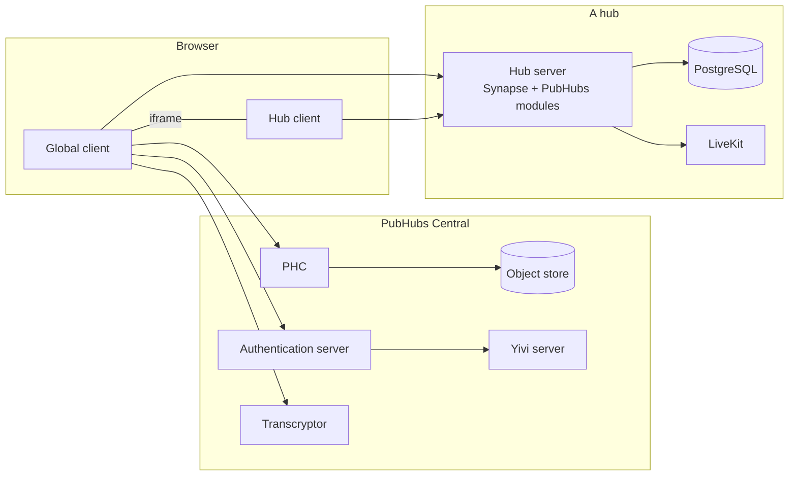

# Architecture

PubHubs is two halves. **PubHubs Central** is run by the PubHubs team: it lets people log in with
Yivi and gives them a different pseudonym for every hub. **Hubs** are run by the organisations they
belong to: each is a Matrix server with its own client, and only ever sees its own pseudonyms. The
global client in the browser ties them together.

## Components

| Component                 | Code                                 | What it does                                                                                                                               |
| ------------------------- | ------------------------------------ | ------------------------------------------------------------------------------------------------------------------------------------------ |
| **Global client**         | `global-client/`, TypeScript and Vue | The PubHubs web app: logging in, the hub list, and switching between hubs, each in a frame                                                 |
| **PHC**                   | `pubhubs/`, Rust                     | The PubHubs Central server: accounts, the list of hubs, and encrypted user objects (settings and keys), kept in an S3 object store         |
| **Authentication server** | `pubhubs/`                           | Turns Yivi disclosures into attributes, and issues the PubHubs card                                                                        |
| **Transcryptor**          | `pubhubs/`                           | Turns a user's pseudonym into the one for a hub, without learning who the user is                                                          |
| **Hub server**            | `pubhubs_hub/`, Python               | Synapse with the PubHubs modules in `modules/pubhubs/`: entering with a pseudonym, secured rooms, hub settings, video calls. Not federated |
| **Hub client**            | `hub-client/`, TypeScript and Vue    | A Matrix client for one hub, built on `matrix-js-sdk`. See [Hub client](hub-client.md)                                                     |
| **Yivi**                  | [yivi.app](https://yivi.app)         | The app people log in with, and disclose attributes with to join secured rooms                                                             |

PHC, the authentication server and the transcryptor together are PubHubs Central: one Rust program,
started with `cargo run serve`.

## Entering PubHubs and a hub

The cryptography is described in the rustdoc of the [`api` module](../pubhubs/src/api/mod.rs) and in
[the paper](https://academic.oup.com/logcom/article/34/7/1377/7319213). In short:

1. **Entering PubHubs.** The global client asks the authentication server to start a Yivi session,
   gets attributes back, and enters PHC with them. PHC answers with an auth token, not a cookie.
2. **Entering a hub.** PHC doesn't learn which hub you enter, and the transcryptor doesn't learn who
   you are. The global client gets a sealed pseudonym package from PHC and a nonce from the hub, has
   the transcryptor encrypt the package for that hub, has PHC sign the result, and hands it to the
   hub. The hub answers with a Matrix access token for your pseudonym there.
3. **User objects**, such as settings, are encrypted by the global client before PHC stores them,
   with a key that only the authentication server can give back to the same user.

`cargo run enter` does the same from the command line.

## Global client and hub client

Each hub client runs in a frame of the global client, on its own domain, so a hub can't read
another's data or the global client's. They talk with `postMessage`, through
`hub-client/src/stores/messagebox.ts` (see there for the messages), for:

- the current room, so the address bar shows the hub and the room;
- settings such as the theme and language;
- the number of unread messages, for the hub's badge;
- dialogs, so a confirmation covers the whole app and not only the frame.

The global client uses parts of the hub client's code, imported at build time.

## Repository

| Path                              | What it holds                                                                                                |
| --------------------------------- | ------------------------------------------------------------------------------------------------------------ |
| `pubhubs/`                        | PubHubs Central: the servers, the `pubhubs` command, and `pubhubs.default.toml` with the local configuration |
| `pubhubs_hub/`                    | The hub server image, its PubHubs modules, and the test hubs (`testhub0` to `testhub4`)                      |
| `pubhubs_hub/matrix_test_config/` | The `homeserver.yaml` for local test hubs, and the example for running a hub                                 |
| `global-client/`                  | The global client                                                                                            |
| `hub-client/`                     | The hub client                                                                                               |
| `packages/`                       | Nix packages, such as the pinned Yivi server                                                                 |
| `scripts/`                        | The scripts behind `mask`                                                                                    |
| `cicd/`                           | The GitLab pipeline                                                                                          |
| `maskfile.md`                     | Every development command, run with `mask` (see [Development](development.md))                               |
| `flake.nix`                       | The development shell and its tools                                                                          |

Inside both clients, `src/` is split the same way, most folders with a README:

| Folder         | What it holds                                                              |
| -------------- | -------------------------------------------------------------------------- |
| `components/`  | Vue components: rendering and interaction                                  |
| `composables/` | Glue between components and stores, services and logic                     |
| `logic/`       | Rules and functions that don't depend on Vue                               |
| `models/`      | Types and classes for the data, named after Matrix where they come from it |
| `services/`    | Fetching and processing data from APIs                                     |
| `stores/`      | Pinia stores                                                               |
